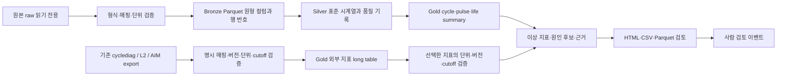

# 전기화학 데이터 통합·지표 추출·이상 원인 검토 로드맵

기준일: 2026-10-22. 이번 산출물은 **전기화학·AIM 관련 지표 목록, raw feature 추출, 실험·설계 비교를 연결하는 로컬 코드와 데이터 구조**다. 이후 제공된 PNE RPT ZIP 4개·Cycle 폴더 1개는 실제 변환 범위에 포함했다. 사용자 정정에 따라 머신러닝 학습이나 예측 모델 구축은 범위에 포함하지 않는다. 원본 이동·삭제, 예약 작업 등록, 모델 학습은 실행하지 않았다. 참고 파일 `C:/LLM_계획서_작성_프롬프트.md`의 현황·후속 행동은 설계 자료로 다루며 현재 대화의 사용자 요청과 구분한다.

## 3.4.0 (2026-10-24): 패키지 정리·효율화와 파생 step/cycle

- **효율화:** 라이브러리 원본 검증은 파일 크기·수정시각 스탬프가 같으면 SHA-256 재계산을 생략한다(`verify="strict"`로 전체 재해시). 프로세스 내 해시 메모, 비교 작업실의 이중 검증 제거, 모듈 해시 1회 계산.
- **파생 step/cycle (원본 열은 그대로, 별도 열/사이드카):** `derived_steps`(step_time 리셋 기준, step 경계 99.96% 일치)와 `derived_cycles`(시험 역할 기반) 사이드카를 `<project>/derived/`에 저장한다. 사이클 라벨이 없는 파일은 작업실에서 `axis_kind=derived_cycle`로 표시한다.
- **제거:** 별도 raw DB(`database-import/scan/query`, `database_workbench`, `pne`, `compact_storage`), raw 키 연결(`knowledge-match/link`, `raw_linking`), 지표 사전 생성기(`catalog`/`prune`, `dedup`), 중복 `catalog/` 폴더. 변환·등록은 프로젝트 라이브러리로 일원화했고 동봉 지표 사전(`resources/catalog`)은 유지한다. 이전 코드는 git 이력에 남아 있다.

## 2026-10-22 추가 구현: 모든 사이클 전압 프로파일 DB

검증된 네이티브 PNE Restore를 ZIP/폴더에서 채널별로 읽고, SQLite 실험 인덱스와 Parquet 시계열·지표를 연결한다. 기본 저장은 모든 사이클의 시간·용량·전압과 구분·출처 정보다. 지표는 전류 등 필드를 생략하기 전에 계산한다. 선택 열/사이클/step, 전류 포함 프로필, 전체 필드, 지표만 저장을 지원하고 압축·생략 내역을 보고한다.

실험 노드와 설계 비교 틀은 유지하며, 물리 셀 연결·설계·배치·시험 조건·RPT 시점을 명시한 집단에 산술평균·표준편차·유효 셀 수를 표시한다. 같은 물리 셀의 여러 시험을 독립 표본으로 늘리지 않는다. RPT 내부 cycle은 수명 cycle과 분리하고 단일 관측점 snapshot을 지원한다.

남은 적용 순서는 **실제 셀·설계·배치 등록표 작성 → 같은 프로토콜/관측점 선택 → 평균과 두 지도 연결 검토 → 필요한 AIM 공식·SOC/CC·CV 매핑의 명시적 확장**이다. 측정 원시값과 압축 정밀도 검증은 지표의 물리적 해석이나 AIM 공식 전체의 검증을 대신하지 않는다.

## 반영한 범위 조정: 수명 관련 중복 지표 제거

사용자의 “중복 지표는 과감하게 없애기” 요청에 따라 `catalog`의 기본 결과를 대표 목록으로 바꿨다. 확인된 589개 사전 항목에서 **223개 대표**를 남기고 **108개 표현/계열/구현 중복 후보를 제외**했다. 보조 150개와 확인 대기 108개는 별도 표로 옮겼으며 중복 삭제 건수에 합치지 않는다. 판정 근거·대표 연결·소스 해시와 정리 전 사전을 보존한다.

동일식 alias → 기준 대비 표현 → 기존 registry의 계열별 대표 → 검토된 legacy 구현 대체 순으로 처리한다. SOC·펄스 시간·충방전·피크 번호 축은 유지한다. legacy와 현재 코드의 피크 번호는 직접 대응시키지 않는다. 기존 family는 시험 조건에 종속된 목록 정책이며 이번 작업에서 실제 셀 상관을 재검증하지 않았다. 적용 규칙과 예외는 [PRUNING.md](PRUNING.md)에 기록했다.

모델 학습이나 성능평가 대신, 대표 지표의 정의·단위·baseline·프로토콜·출처를 검증하고 실제 export에 연결하는 것을 다음 단계로 둔다. 이 변경은 기존 계산 엔진을 건드리지 않고 주 목록과 신규 정리 코드에 적용했다.

## 반영한 범위 확장: 설계와 전기화학, 두 가지 실험 지도

점 하나는 사용자가 선택한 **셀별 시험 하나**다. `update/watch`는 raw 추가와 등록표 변경을 반영한다. 관계를 한 가지로 섞지 않고 다음 두 지도를 독립 계산한다.

1. **전극 설계·재료:** 양·음극 활물질, 고체전해질·도전재·바인더, 완전한 전극 조성, 명시한 단위·면적 기준의 로딩. 설계 등록이 완료되면 raw 대기 중인 셀도 표시한다.
2. **전기화학 지표:** 처리된 raw와 검증된 외부 export에서 같은 관측창으로 만든 대표 지표. 중복 family를 제한하고 공통 지표가 부족하면 연결을 보류한다.

동일 실험을 선택한 채 지도를 전환하고, 두 점수를 나란히 비교해 **유사 설계·다른 반응**, **다른 설계·유사 반응**을 검토한다. 소재·조성·로딩은 전기화학 점수에 넣지 않는다. 설계 유사도는 정의한 비교 기준에 따른 거리이며 성능·원인·수명 예측 점수가 아니다.

설계 기본 템플릿은 12개 항목이다. 단면 면적 용량 로딩 `mAh/cm²`를 기본으로 두고 질량 로딩 `mg/cm²`, 압착 밀도, 독립 전해질막, 활물질 내부 blend는 선택 템플릿으로 제공한다. 같은 로딩의 파생 표현은 동일 group으로 두어 중복 가중을 막는다. 값과 단위·조성 분모가 확인되지 않으면 미기재로 남긴다. 실제 cell registry는 아직 연결하지 않았다.

코드·합성 raw 12셀 예시는 구현됐으며, 실제 적용은 **등록표 작성 → 3–5셀 수치 대조 → 두 지도 이웃 검토 → 새 raw 갱신 검증** 순으로 진행한다. [RELATIONS.md](RELATIONS.md)에 입력·계산·실행 방법을 정리했다. UI 실행은 로컬이며 상시 서비스나 예약 작업을 설치하지 않는다.

## 2026-10-22 추가 구현: 선택형 비교 작업실

이전 제안의 7개 기능을 `workbench` 명령과 로컬 API로 연결했다. 기능 표시·분석 산출·실제 비교 차원을 별도로 선택하고 저장/불러오기한다. 교차 검색 → 원곡선·이상/품질 근거 → 조건 비교를 이어서 사용하고, 등록·구간 변화·반복 셀·고정 기준·이력도 켜고 끌 수 있다. 선택형 CC/CV·SOC별 DCIR·휴지 응답은 검증된 실측 조건에 한해 추가하며 기본 선택에서 제외한다.

원본 대신 출력 폴더에 등록 복사본을 저장한다. 상세 계약·한계·실행 방법은 [WORKBENCH.md](WORKBENCH.md), 실제 테스트 집계는 `validation_summary.json`을 참조한다. 기능 구현과 합성 검증은 실제 raw 전환, AIM 공식 명세 확인, 실험적 인과 검증을 대신하지 않는다.

## 1. 목표와 완료 기준

목표는 셀·시험·사이클별로 다음 질문에 답할 수 있는 데이터 구조를 만드는 것이다.

1. 어떤 raw와 어느 행에서 계산한 지표인가?
2. 용량·효율·저항·휴지·곡선 지표 중 무엇이 언제부터 변했는가?
3. 측정 이상, 조건 차이, 실제 퇴화의 후보 근거가 각각 무엇인가?
4. AIM 등 기존 수명 지표와 원시계산 결과가 같은 단위·정의·관측 범위인가?
5. 단일 변수 비교인가, 온도·압력·채널·프로토콜 등의 교란이 남아 있는가?

| 단계 | 정량 완료 기준 | 이번 구현과의 관계 |
|---|---|---|
| 입력 신뢰성 | 허용 형식 파일마다 SHA-256·원본 레코드 번호 100% 보존; 잘못된 행을 묵시적으로 삭제하지 않음 | 입력·출력 manifest 및 엄격 검증 구현 |
| 재현성 | 동일 입력·설정·코드·런타임은 같은 run ID; 재실행 시 산출물 해시 검증 | 구현 |
| 지표 통합 | 외부 지표의 ID·단위·정의 버전·원본 코드 revision·관측 cutoff 100% 명시 | 구현; AIM 실제 명세 연결은 대기 |
| 의미 검증 | 대표 셀/시험으로 기존 엔진 결과 대조; 용량 상대 오차 ≤0.1%, CE 차이 ≤0.05%p를 초기 목표로 설정 | 후속 검증 목표이며 아직 충족 주장 없음 |
| 저항·미분 | 동일 전류 전환·SOC·온도·시점·필터 조건에서 비교; 해상도/분해능에 따른 허용 오차 별도 합의 | 후속 검증 |
| 이상 검토 | 모든 경고에 관측값·기준값·근거·출처·사람 검토 상태 포함; 자동 셀 제외 0건 | 검토용 규칙 및 주석 로그 구현 |
| 수명 관련 지표 정리 | 지표별 관측 구간·baseline 명시, 관측 중단 구분, 미래 cycle 사용 여부 100% 표시 | 관측 수명 요약 구현; 모델 학습은 완료 조건이 아님 |

수치 목표는 설계용 제안이다. 다른 적분·필터·baseline 정의에서 차이가 나면 결과를 억지로 맞추지 않고 정의 차이를 먼저 기록한다.

## 2. 실제 확인한 자산과 자료에만 있는 현황

사용자가 표시한 경로 문자열과 실제 폴더 이름에 차이가 있어 다음 기존 폴더를 읽기 전용으로 확인했다.

| 이번 세션에서 읽은 자산 | 확인한 역할 | 재사용·보완 방식 |
|---|---|---|
| `C:/Users/LGES/Cursor/data_analysis` | `cycle_analysis/l2.py`의 cycle/RPT 분류, CE·retention; `analyze.py`의 `L2_cycles.jsonl`, `L2_rpt_dcir.jsonl`, `L2_dvdq_soc0.jsonl` export | JSONL/CSV/Parquet export를 명시 매핑으로 읽음. L2의 CE·retention은 비율, 용량은 mAh |
| `C:/Users/LGES/Cursor/data_analysis_projects` | cycle, QPEED 등 프로젝트별 기존 분석 코드 | 프로젝트별 정의·입력 스키마·revision을 catalog에 등록하고 공통 export 계약 사용 |
| `C:/Users/LGES/Cursor/pne_studio2` | DB pipeline과 `db_pipeline/lgensol/func_feature_extract.py`의 기존 feature 추출 | 기존 결과를 검증된 CSV/Parquet로 export하여 연결. 기존 모듈이나 pickle을 새 파이프라인에서 실행하지 않음 |
| `C:/Users/LGES/Cursor/cyclediag` | `features/lges_catalog.py`, `indicator_registry.py`, `cycle_indicators_export.py`; 용량·DCIR·휴지·미분·곡선·진단 지표와 중복 family/역할 관리 | 기존 카탈로그와 export 재사용. 동일 물리량의 alias를 독립 증거로 중복 합산하지 않음 |

`cyclediag/features/lges_extract.py`에서 `dchgCapa/chgCapa`는 Ah, `CE/SoHQ`는 %임을 확인했다. `data_analysis/cycle_analysis/l2.py`는 mAh와 0–1 비율을 사용한다. 같은 이름 `CE`라도 값을 그대로 병합하면 100배 오류가 생긴다.

**AIM의 정확한 지표 목록·정의·원본 구현 위치는 현재 확인되지 않았다.** `aim`은 기본 `not_configured`이며, 알려지지 않은 식·성능·진단 임계값을 새로 지어내지 않는다. 명시적 실제 export 매핑이 제공되면 동일 adapter에 연결할 수 있다.

실제 정적 inventory 결과는 파일 **2,947개**, feature 후보 **1,336개**, 선택된 함수·클래스 심볼 **362개**다. 파일 크기 제한 등 **15건의 제한**으로 `complete=False`이며 전체 지표를 완전히 열거한 결과가 아니다. `claim`, `TgaImageFile`처럼 `aim` 문자열이 우연히 들어간 심볼은 AIM 구현의 근거로 인정하지 않았다. 이 스캔에서 의미가 확인된 AIM 구현은 발견하지 못했다.

참고 문서의 `D:/Workspace/Data_optimization`, `D:/2026`, `F:/DB_Pipeline_Package`, 총 17.8 GB 등은 **참고 문서의 진술**이다. 이 로드맵은 해당 경로·파일 수·디스크 여유·완료 단계를 이번 세션에서 재검증했다고 주장하지 않는다. 기존 datalake가 실제로 접근 가능하면 그 저장소·DuckDB catalog를 확장하는 것이 다음 단계다. 이번 독립 패키지의 SQLite는 실행 이력 catalog이며 기존 DuckDB를 대체하려는 설계가 아니다.

## 3. 저장 및 처리 구조



현재 run 저장 구조:

```text
<output_root>/
  catalog.sqlite3
  runs/<run_id>/
    input_snapshot.json
    config_snapshot.json
    run_manifest.json
    feature_dictionary.json
    bronze/<test_partition>/part-*.parquet
    silver/<test_partition>/part-*.parquet
    gold/{cycles,pulses,quality,diagnostics,life_summary,external_features}.{parquet,csv}
    report.html
    review_events.jsonl  # 사람이 review 명령을 사용한 경우
```

- Parquet(zstd): 컬럼 선택 읽기와 압축을 지원하고 분석 도구 간 교환이 쉽다.
- Bronze: 원본 파일을 별도 보존한 상태에서 원형 컬럼을 저장한다. Parquet가 원본 바이트 전체를 대체하지 않는다.
- Silver: 명시된 전류 부호, 시간·전압·전류·용량 단위, step/시험 분류를 사용한다. 불명확한 채널→셀 매칭을 파일명만으로 확정하지 않는다.
- Gold: 전체 시계열과 작은 분석 테이블을 분리한다. 내부 cycle/pulse는 사용하기 쉬운 wide, 외부 지표는 정의·단위·버전이 붙는 long 구조다.
- 대용량 운영 시 `experiment_id/test_id` 중심 파티셔닝과 compact 파일 크기를 benchmark한다. 셀·cycle 단위의 수많은 작은 Parquet는 피한다.
- 청크를 이어 cycle 단위로 분석하되, 비정상적으로 큰 cycle에는 설정된 상한을 적용한다. 외부 feature export reader는 현재 메모리에 읽으므로 원시 대용량 파일 대신 요약 export에 사용한다.

## 4. 데이터 계약과 핵심 테이블

| 테이블 | 핵심 필드 | 상태 |
|---|---|---|
| raw manifest | `path`, SHA-256, bytes, `cell_id`, `test_id`, 명시 매핑·단위·조건 | 구현 |
| Silver timeseries | 셀/시험/cycle/step, 시간, V, A, 용량, 온도, 원본 행·해시 | 구현 |
| Gold cycles / pulses | 셀/시험/cycle, 추출값, 완결성·유효성, 원본 행 구간 | 구현 |
| external_features | `cell_id,test_id,cycle,metric_id,value,unit,definition_version,source_revision,observed_until_cycle,source_sha256,source_row` | 구현 |
| diagnostics | 지표·값·기준·robust score·원인 후보·confidence·review status·출처 | 구현 |
| external diagnostic screening | 명시한 외부 metric과 검증된 raw cycle 연결, 단위·정의·revision·관측 cutoff 검증 | `external_screen.py` 구현; `external_diagnostics.metrics`에 등록한 지표만 실행 |
| life_summary | 확인된 EOL, EOL 미도달/관측 중단, early cutoff·관측 수·초기 경향 | 구현; 학습된 수명 예측 아님 |
| review_events | run, 대상, 판단, 이유, 검토자, 시각 | append 이벤트 구현 |
| cell_registry | 소재·조성·공정·로딩·NP·막두께·집전체·형식·배치 | CSV/XLSX 등록 가져오기·검증 구현; 비정형 셀 로그 자동 정규화는 후속 |
| tests/channel_mapping | 장비·채널·구간·시험 종류·프로토콜 해시·셀 매칭 근거 | manifest 명시 입력 우선; 자동 매칭은 후속 |
| feature_registry | 식/알고리즘·단위·role·family·필수 입력·유효 범위·불확실성 | 기본 사전·AST 후보 inventory 구현; 전체 의미 검토는 후속 |

외부 지표 키는 `cell_id,test_id,cycle,metric_id,definition_version,source_revision`이다. 충돌하면 값을 임의 평균하거나 첫 행을 선택하지 않고 실패한다. SOC·pulse duration·충방전 방향이 다른 저항은 별도 `metric_id`로 명시하거나 사전에 wide pivot한다. `L2_rpt_dcir`의 반복 SOC 행을 cycle만으로 병합하지 않는다.

`source_revision`은 전체 40자리 Git commit 또는 전체 64자리 SHA-256을 요구한다. 이것은 사용자가 지정한 코드 provenance이며, export 파일의 실제 `source_sha256`과 별도다. 코드 해시만으로 정의·검증 완료가 보장되지는 않는다.

## 5. 지표 범위와 재사용 순서

| 지표군 | 분석 목적 | 이번 구현 / 연결 | 후속 의미 검증 |
|---|---|---|---|
| charge/discharge capacity, CE, retention | 기초 상태·효율·열화 경향 | raw 계산 + cyclediag/L2 adapter | 불완전 cycle, RPT vs 수명 baseline, 채널 전류 오프셋 |
| 에너지·평균 전압·CC/CV | 분극·충전 양상 변화 | raw 지표 | CV 판정 프로토콜, 충전 종료 조건 |
| DCIR·pulse·EoC/EoD | SOC·시간별 저항 상승 | 유효 pulse의 시간별 저항 및 기존 export 연결 | 전환 시점, 0.1/10/30/60 s 실제 sampling, 온도·SOC 정합 |
| 휴지 전압·relaxation | 평형 접근·자기방전 후보 | 휴지 지표 및 기존 export 연결 | 휴지 길이, OCV settling, 온도·접촉 영향 |
| dQ/dV·dV/dQ·peak | 반응·곡선 변화 | 기본 미분/피크 + 기존 상세 지표 adapter | smooth/grid/resolution·정규화·peak matching 고정 |
| dV/dQ@SOC0, cliff, shape | 저SOC transport 관련 후보 | 기존 cyclediag feature를 정의별 import 가능 | cycle별 용량축 변화·SOC 기준·불완전 방전 |
| LLI/LAM/impedance/transport/plating/contact score | 여러 지표의 패턴 요약 | 기존 카탈로그·export 보존; 확정 원인으로 취급하지 않음 | reference electrode/half-cell, 조건 통제, 독립 증거 대조 |
| QPEED/QC, HPPC Imax | 급속충전 성능·pulse 한계 | 기존 프로젝트 export bridge | SOC10→80 정의, 온도·전압 제한·저항 조건 |
| GITT/EIS/XRD/swelling | 원인 후보 독립 검증 | 이번 직접 분석 범위 밖 | 검증된 parser와 시간·셀·시험 매칭 후 확장 |
| AIM 수명 관련 지표 | 사용 중인 지표 전체의 정의·단위·산출 조건 정리 | 기존 코드 카탈로그와 export 연결 구조 구현; AIM 명칭과의 대응은 미확인 | 공식 지표 목록/원본 코드와 항목별 대조, 식·단위·baseline·관측 범위·계산 불가 사유 확보 |

“모든 지표”의 현실적인 완료 정의는 **이름을 많이 수집하는 것**이 아니라, 기존 카탈로그와 실제 export 컬럼 전부에 대해 `채택/보류/alias/target/QC/metadata`를 빠짐없이 결정하는 것이다. AST inventory는 정적 문자열과 함수 이름만 추출하므로 f-string/loop로 생성되는 peak·SOC 컬럼을 완전하게 열거하지 못한다. 실제 export header와 대조하는 검토 단계가 필요하다.


### 지표 사전에 남길 단위·정의 충돌

정적 코드로 확인한 아래 차이는 실제 export 단위 검증의 우선 항목이다. 단위는 이름의 접미사만으로 확정하지 않고 `source namespace + 식 + 입력 단위 + revision`으로 관리한다. 확인 전 값은 `needs_review`로 보존한다.

| 항목 | 확인한 정의/단위 | 대조 시 주의 |
|---|---|---|
| cyclediag `CE`, `SoHQ` | % | L2의 0–1 비율과 변환 필요 |
| cyclediag `EE`, `VE` | 무차원 0–1 비율 | CE와 같은 %라고 가정하지 않음 |
| cyclediag `CI_per_hour` | (100−CE)/시간(h), %p/h | CE의 단순 alias와 시간 정규화 지표를 구분 |
| cyclediag `chgCapa_CCratio` | CC용량/전체 충전용량×100, % | Studio 동명 지표는 CC용량/초기 CC용량×100이라 별도 정의 |
| Studio `EoC_V1/V10/V30`, `EoD_V1/V10/V30` | 휴지 60/600/1800초의 V | 접미사 1/10/30은 이 코드에서 분 단위 |
| Studio `delta_EoC_*`, `delta_EoD_*` | 기준 전압 차이×1000, mV | cyclediag의 전압 `delta_*`는 V; 동일 delta 규칙 적용 금지 |
| cyclediag `hyst_area` 및 band 면적 | 0–1 정규화 용량축에서 전압차 적분, V | Wh 에너지 면적과 구분 |
| cyclediag `*_ir_drop_proxy` | 초기 샘플 간 전압차, V | 전류로 나눈 저항(Ω)이 아님 |
| raw 용량축을 쓰는 미분·피크 높이·에너지 | 입력 Q 단위와 정규화 설정에 종속 | Ah/mAh, V/Ah·V/SOC, Wh/mWh를 입력·산식에서 확인 |
| Studio `EoC_dchgR/EoD_chgR` | 전류 절댓값 10을 기준으로 ×1000 분기 | 단위 선언이 아닌 크기 추정이므로 검증 전 저항 단위 미확정 |
| `CI`와 `CE` 등 retired alias | CI=100−CE 같은 변환 관계 | 컬럼 이름만 바꿔 같은 수치를 넣지 않고 변환식을 보존 |
| cyclediag `CE_rev` | 다음 cycle 충전량/현재 방전량×100, % | 현재 cycle보다 뒤의 기록을 사용하므로 관측 cutoff에 표시 |

위 단위 근거는 `cyclediag/features/lges_extract.py`, `lges_extra_indicators.py`, `signal_cv.py`, `indicator_registry.py` 및 `pne_studio2/db_pipeline/lgensol/func_feature_extract.py`에서 확인했다. 목록에 이름이 있다는 사실과 단위·계산법이 검증됐다는 사실은 구분한다. 기존 registry에서 알 수 없는 이름을 indicator로 분류하는 기본 동작도 이번 사전에서는 검토 완료의 근거로 쓰지 않는다.

## 6. 이상 지표를 한눈에 보는 검토 방식

검토 표에는 `cell/test/cycle → 이상 지표 → 기준 대비 변화 → 가능한 원인 → 반증/추가 확인 → 출처`를 둔다.

| 관측 패턴 | 원인 후보 | 함께 확인할 정보 |
|---|---|---|
| CE 급변 + 전류/시간 문제 | 채널 오프셋, 로그 누락, 불완전 cycle | 장비 범위·저전류 교정, End record, 적분 구간 |
| 용량 급락 + DCIR/전압 변화 | 분극 증가, cutoff 조기 도달, 접촉 변화 | 동일 SOC/온도 저항, 전압곡선, 압력·지그 이력 |
| 반복 저효율 + 휴지 전압 변화 | side reaction/자기방전 등 | 온도/휴지 길이, 보조 시험, 센서·채널 문제 |
| dV/dQ@SOC0 증가 + 저SOC 곡선 변화 | transport 관련 저항 증가 후보 | 방전 완결성, 용량축·C-rate·필터 정합 |
| 단발성 극단값 | 기록 이상 또는 실제 사건 | raw 구간, 이후 회복/반복, 다른 독립 신호 |

위 표는 해석 가이드다. 특정 지표 하나로 미세단락·plating·LLI/LAM을 확진하지 않는다. 원인 후보 rule의 `confidence`는 검증된 임상적/통계적 확률이 아니다. 작은 n에서는 셀 개별 궤적과 반복성·조건 차이를 우선 제시한다.

외부 지표 원본은 별도 표에 보존한다. 구현된 `external_screen.py`는 `external_diagnostics.metrics`에서 선택한 지표만 `cell_id,test_id,cycle`로 완결성 근거가 있는 raw cycle과 연결한다. 단위 불일치, 같은 cycle에 중복된 지표 버전, 서로 다른 정의·source revision의 혼합은 오류로 중단하고, 매칭되지 않은 기록은 경고로 남긴다. `observed_until_cycle > cycle`인 미래 관측 정보는 기본값에서 진단에 사용하지 않는다. 사용자가 `allow_retrospective=true`를 명시한 회고 분석은 결과에 그 사실을 기록하며 당시까지 관측한 지표와 구분한다.

진단 규칙을 등록할 때 `role=indicator`, 독립 `family`, 조건 정합을 사람이 검토한다. 현재 코드가 전기화학적 의미나 family 독립성을 자동 보증하지는 않는다. CE와 100−CE, 원값과 delta, 용량과 SoHQ를 각각 독립 원인 증거로 점수 합산하지 않는다.

## 7. 변수 통제와 지표의 관측 범위

- 비교 변수 사전: 소재·배치, 전극 비율/로딩, NP, SE 두께(µm), 집전체, 압력(MPa), 온도(°C), C-rate, voltage limit, formation, cycler/channel, protocol revision, filter/config hash.
- 한 변수 비교: 변경 대상 1개를 지정하고 나머지 통제 변수의 동일성을 확인한다. 값이 없으면 “같음”으로 처리하지 않는다. 단위 변환 전 문자열만으로 0.7/0.8 MPa를 동등 취급하지 않는다.
- 비교 출력: 바뀐 변수, 일치/불일치/미기재 통제 변수, 각 셀 수, 효과크기, 개별 곡선. n=1은 반복성이 입증된 결과로 표현하지 않는다.
- 특정 cycle까지의 비교에는 `observed_until_cycle <= analysis_cutoff`인 지표만 사용한다. 전체 기록으로 fitting/smoothing하거나 다음 cycle을 참조한 legacy 지표는 사용한 관측 범위를 별도로 표시한다.
- 통계적 경향·상관관계 표시는 선택사항이다. 지표 사전 완성과 원시계산 대조를 먼저 끝내며, 동일 셀의 여러 cycle을 독립 셀 반복수처럼 세지 않는다.
- EOL threshold와 연속 확인 cycle 수를 사전에 지정한다. EOL 미도달을 임의 추정 수명으로 채우지 않고 censored로 남긴다. EOL을 지나치게 늦게 관측한 경우 sampling 간격과 interval uncertainty도 후속에 기록한다.
- AIM 지표 연결 완료 시 기록할 항목: 목록의 출처와 원본 코드 revision, metric ID, 식/알고리즘, 단위, 입력 컬럼, 충방전 방향, SOC·pulse 시간·온도 조건, baseline·window·필터 설정, 관측 cutoff, 계산 가능 조건, alias·role·family, 대조 결과. 기존 계산값에 진단 점수가 포함되면 산식과 검증 범위를 함께 표시한다.

## 8. 단계별 로드맵

| 단계 | 산출물 | 완료 기준 | 작업량 | 선행 |
|---|---|---|---|---|
| P0 자산/명세 고정 | 현재 코드 inventory, 실제 데이터 형식 샘플, AIM 위치·명세, source manifest | 테스트·셀·채널 키와 단위에 모호함 없음 | 중 | 없음 |
| P1 저장 파일럿 | 3–5개 대표 셀·시험의 Bronze/Silver, provenance, quarantine **목록** | 행 수·해시·범위 확인, raw 수정 0건 | 중 | P0 |
| P2 기존 지표 통합 | cyclediag/L2/DB export→long, feature registry | 실제 export header에 대해 미검토 지표 0개; alias/role 검토 | 중 | P1 |
| P3 지표 대조 | 기존 도구와 수치·곡선 비교표, 회귀 fixture | 합의한 지표별 허용 오차 충족 또는 정의 차이 설명 | 상 | P2 |
| P4 이상 근거 표 | 품질/퇴화 경고 분리, family 기반 규칙, 검토 이력 | 알려진 사건 재현, 자동 삭제 0건, 오탐 검토 | 중 | P3 |
| P5 AIM 지표 사전 완성 | AIM 원본 목록↔코드↔export↔표준 metric 대조표, 정의·단위·alias 사전 | 확인된 원본 목록의 모든 항목에 채택/보류/alias/대체/계산불가와 근거 기록; 미검토 0개 | 중 | P2–P4, 실제 AIM 목록 확보 |
| P6 운영 | 변경 파일만 재계산, 실패 격리 목록, CLI/SQL, Origin/장표 연계 | 재실행 복구, 실행 시간·디스크 benchmark | 중 | P4 |
| P7 확장 | EIS/GITT/XRD, 셀 로그 정규화, 필요 시 간단한 UI | 각 parser/모듈의 독립 검증 통과 | 상 | 관련 P3 |

1인 운영 기준 첫 2주 계획(작업 시간은 데이터 확인 난이도에 따른 가정):

| 일자 | 작업 | 당일 확인물 |
|---|---|---|
| 1일 | 실제 데이터·AIM 경로 확정, 코드 inventory, 셀/시험 키 설계 | 명세 gap 목록과 샘플 선정 |
| 2일 | 대표 CSV의 header/단위/step/time 확인, 원본 SHA 고정 | 명시 config 3–5건 |
| 3일 | Bronze/Silver 파일럿, cycle 경계·정지/재시작 점검 | raw 대비 행 수·예외 표 |
| 4일 | capacity/CE/energy/완결성 대조 | 기존 도구 수치 차이표 |
| 5일 | DCIR·rest·미분 feature 대조 | 유효성 조건과 제외 아닌 경고 사유 |
| 6일 | 기존 cyclediag/L2 export 전체 카탈로그 매핑 | 단위·role·family·baseline 사전 |
| 7일 | 알려진 이상 셀의 경고·원인 후보 리뷰 | 오탐/미탐 목록 및 rule 수정 기록 |
| 8일 | registry 표와 단일 변수 비교 구성 | 교란 변수 및 누락값 표 |
| 9일 | AIM 원본 목록과 기존 카탈로그·export 컬럼을 항목별 대조 | 누락·중복·동명 다른 정의·계산불가 목록과 보완 우선순위 |
| 10일 | 재현 실행·회귀 테스트·성능/저장 benchmark | 파일럿 인수 결과와 다음 우선순위 |

## 9. 검증·운영 경계

| 위험/미완료 | 처리 |
|---|---|
| `.cyc`, headerless Restore CSV, ragged StepEnd, `.mpr` | 이번 generic reader에 직접 투입하지 않는다. 기존 검증된 converter/export를 먼저 사용하고, 전용 parser를 별도 golden fixture로 검증 |
| 단위·전류 부호·시간 원점 | 자동 추정 대신 명시 config; step 경계·리셋·음수/정지 시간 확인 |
| 빈 값/계산 불가 | NaN·quality reason으로 보존; 0으로 바꾸지 않음 |
| DB2의 이상치 제거/보간 | 기존 설정·제거 사유·cutoff를 함께 기록. 입력 제거된 결과만으로 raw 정상 여부 단정 금지 |
| C: 용량 | 이번 코드 산출물은 작업 공간. 운영 저장 위치는 실제 여유 확인 후 지정; 참고 문서의 D: 권고를 현재 권한/가용성 사실로 취급하지 않음 |
| 외부 지표 개인정보/회사 데이터 | 모든 reader와 inventory는 로컬. raw나 소스 내용의 원격 업로드 없음 |
| UI/자동화 | CLI·정적 HTML·사용자 실행형 watch·로컬 작업실 API/UI 구현. 운영 raw 상시 감시·예약 작업·배포는 미수행 |
| 원본 정리 | 분석과 분리. 이번 패키지에 purge·원본 삭제 없음 |

회귀 fixture는 합성 데이터의 알려진 적분값·저항값, 시간 reset, cycle 경계, 단위 혼합, 불완전 cycle, 중복 키, future cutoff, alias, observation censoring을 포함한다. 이후 실제 셀 fixture는 회사 정책이 허용하는 로컬 위치에 고정하고 원본 해시로 식별한다.

## 10. 남은 결정과 바로 할 첫 작업

우선순위는 AIM의 공식 지표 목록 또는 해당 원본 코드·export의 위치, 대표 셀·시험의 기준 결과, cell/test registry와 EOL 정의, 운영 출력 드라이브 순이다. AIM 목록이 문서·Excel·코드·내보낸 표 중 어디에 있는지를 먼저 확인하고 각 항목의 정의와 산출 여부를 대조한다. 이 확인이 없어도 raw 저장·기본 지표·외부 feature 계약은 독립적으로 사용할 수 있다.

실제 데이터 운영 전에 수행할 명령(프로젝트 루트에서 실행):

```powershell
# 1. 설치 및 회귀 검증. 원본 데이터는 읽지 않는다.
python -m pip install -e ".[test]"
python -m pytest -q

# 2. 기존 코드의 정적 feature 후보 및 함수 inventory. 모듈 실행 없음.
python -m battery_insight inspect --roots "C:\Users\LGES\Cursor\data_analysis" "C:\Users\LGES\Cursor\data_analysis_projects" "C:\Users\LGES\Cursor\pne_studio2" "C:\Users\LGES\Cursor\cyclediag" --out ".\work\asset_inventory.json"

# 3. 샘플 config의 컬럼/단위/셀·시험 ID를 실제 export에 맞춰 명시한 다음 파일럿 실행.
# 아래 <...>는 사용자가 검토한 경로로 치환한다.
python -m battery_insight run --config "<검증한 config.json>" --out "<충분한 여유가 있는 로컬 출력 경로>"
```

코드는 실제 운영 실행을 대신하지 않는다. 전체 데이터 전환·AIM 지표 대조 완료·특정 셀의 이상 원인을 이미 검증했다고 주장하지 않으며, 이 로드맵의 P1–P7 완료 여부는 실제 파일럿 증거로 갱신한다.
# 장표 기반 실험·샘플 DB 확장 (2026-10-22)

기존 raw 저장·전기화학 지표 DB 위에 장표의 실험 맥락을 연결하는 별도 레지스트리를 추가했다. 먼저 장표를 한 개씩 정리하고, 확인된 실험·샘플을 기존 raw 시험 ID에 연결한다. 실제 장표가 오기 전에는 실제 연결을 만들지 않는다.

| 순서 | 현재 구현 / 다음 작업 | 완료 기준 |
|---|---|---|
| 1. 장표 수집 | PPTX/PDF 본문·표·노트와 페이지/슬라이드 근거 수집 구현 | 원본 SHA, 근거 ID, 추출 한계·이미지 판독 대기 기록 |
| 2. 실험·샘플 등록 | SQLite 문서/근거/샘플/실험/수정 이력 구현 | 날짜 의미, 문자열 세트번호, 번호 범위, 샘플/셀 구분, 누락 질문 기록 |
| 3. raw 후보 연결 | 명시한 시험 시작일·세트·범위·시험 종류로 후보 생성 구현 | 채널·RPT 시점·샘플 충돌 검사, 유일 후보도 확정 이벤트 필요 |
| 4. 비교 반영 | 별도 overlay와 기존 DB 작업실 연동 구현 | 원곡선·지표 불변, 명시적 물리 셀 ID만 별칭 연결, stale/충돌 보류 |
| 5. 첫 실제 장표 | 사용자 자료 수령 후 진행 | 실제 용어·날짜/번호 규칙·단위·샘플/채널 대응을 확인해 첫 기록 추가 |
| 6. 후속 확장 | OCR·복잡한 표/범례·화면 내 편집·여러 문서 변경 이력 | 실제 장표로 정확도/누락을 확인한 뒤 독립적으로 추가 |

정리할 필수·선택 항목과 작업 절차는 [장표 등록 준비 안내](knowledge_intake_guide.html)에 유지한다. 실험 목적·샘플명과 물리 셀을 구분하며, 제조일·보고일은 시험 시작일의 대체 키로 사용하지 않는다. 평균 정책과 AIM 지표 정의의 검증 범위는 기존과 동일하다.

